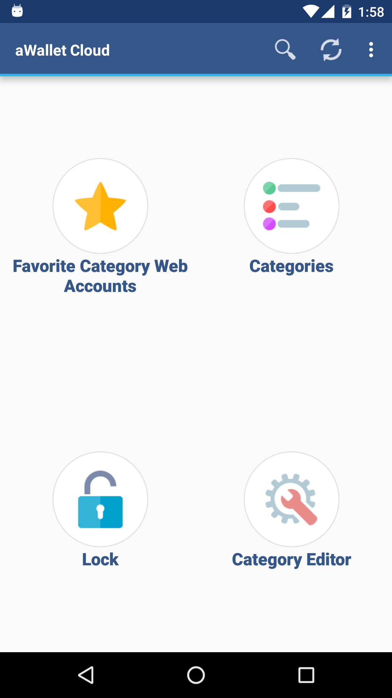
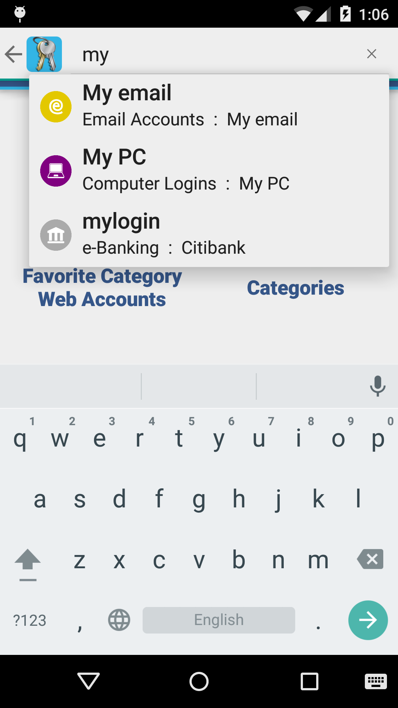
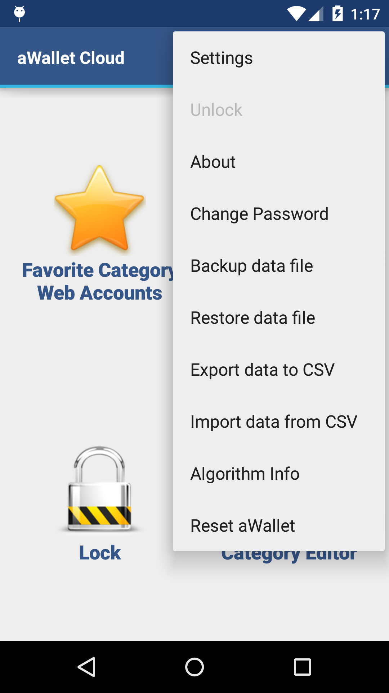
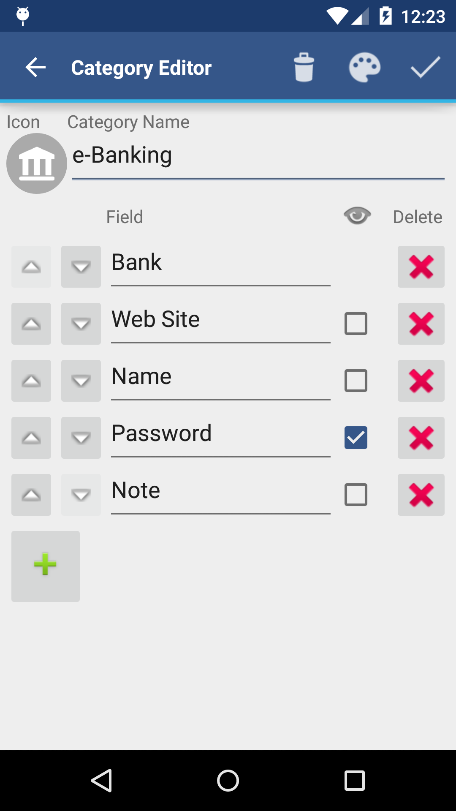
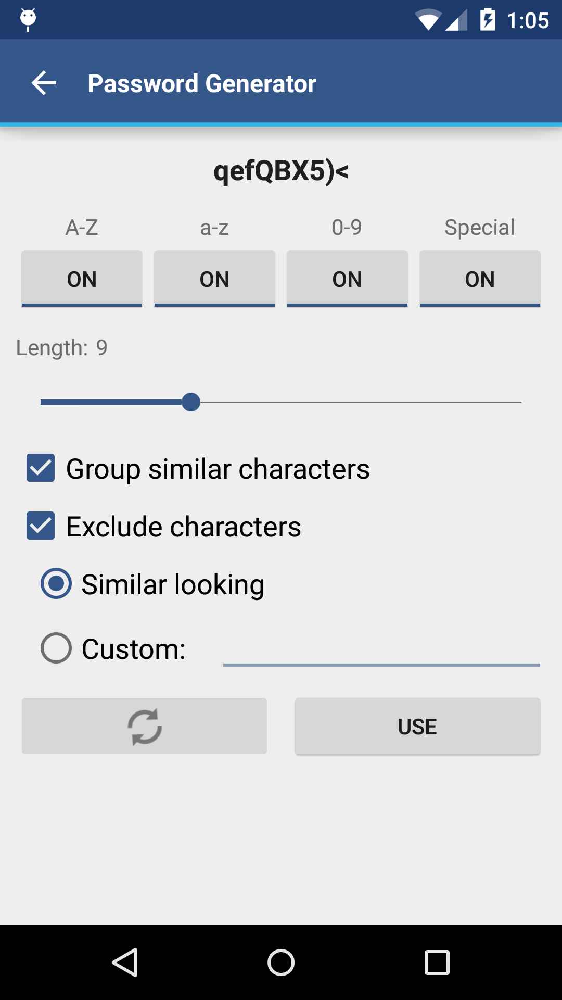

# Documentation

## Basic info {#h.5z61es1tafnm}

aWallet is an Android and iOS app for keeping your passwords and other secret data safe. It organizes your data into categories. Categories can be created and customized anytime using the Category editor.

## Initial setup {#h.p923enb24xeq}

When aWallet is started for the first time and you press one of the home screen buttons, aWallet will ask you to choose an encryption algorithm and password. After that, you are ready to use aWallet.

## Home (Main) Screen {#h.vs76n81oads}

The Home screen contains 4 icons that allow you to:

- Access your favorite Category
- Access all Categories
- Define new or modify existing Categories (by using the Category editor)
- Lock aWallet (auto-lock is supported as well)
- Search for entries
- Cloud version only: Manually invoke Cloud synchronization

  - Automatic synchronization can be turned on in Settings.

{ .screenshot }

## Searching {#h.9h6993xum5yb}

Search is available on the Home and Categories screens. Hidden fields (e.g. passwords) are not included in search results.

Searching is invoked by either pressing the Search icon at the top right corner on home or Categories screens. Or by pressing the hardware search button on your phone if this button is available.

{ .screenshot }

## Menu {#h.uetta2yaw4ny}

When you are on the Home screen and press the menu button on the phone, you get access to less frequently used features. From the menu, you can access Settings, change the password and encryption algorithm. Or you can backup/restore the data file to/from the USB storage, reset aWallet, etc. 

Note that: Some menu items (like Settings or Data file backup) are only available when aWallet is unlocked. Some menu items are available when it makes sense to use them, e.g. "Restore data file" when a backup file exists on the USB storage in the appropriate folder.

{ .screenshot }

## Category editor {#h.etkbfnh22yvr}

In the Category Editor, you can define or change the structure or label names of your data Categories. The Category icon can be changed by tapping the icon in the editor.

You will probably use the Category Editor rarely. It is only used to customize aWallet to your needs. This is typically done in the very beginning. In most cases, you will be adding Category Entries using the "Favorite Category" or "Categories" home screen icons.

Note that: If you delete a Category field in the Category editor, you will also delete its field data in all Entries. E.g. when you delete the password field in Web Accounts, all passwords in the Web Accounts category will be lost! If you delete a Category in the Category Editor, all data that belong to that Category will be lost as well!

{ .screenshot }

## Password Generator {#h.1r61w29pnl25}

Password Generator is available in the Entry Editor. It can be started by pressing the pencil icon which is available for hidden fields (passwords, PINs, etc.). 

Password Generator uses a cryptographically secure pseudorandom generator. Generated passwords or PINs are therefore practically impossible to predict.

{ .screenshot }

## CSV Import {#h.59q1c0fbtxom}

aWallet allows you to import CSV files into Categories. This feature is useful when you want to enter a large amount of data or when you want to import your data from another password manager. 

NOTE: If you are using Android 11 or newer: Use this [guide](https://support.google.com/android/answer/9064445) to connect phone via USB cable.

CSV files to be imported have the same simple format and file location in the phone storage as CSV files that are exported by aWallet. To find the correct place where to put CSV file(s) do CSV Export first: on the main screen press the Menu button | More | Export data to CSV and choose existing or create a new folder.

Now transfer exported files to your PC and modify them in a spreadsheet app (MS Excel, OpenOffice, ...). When finished transfer files back to your phone. Unlock aWallet and on the main screen press the Menu button | More | Import data from CSV.

If the CSV file contains any national characters make sure it was saved using UTF-8 encoding in the spreadsheet app.

Each CSV file is imported to its own Category. The CSV file name (without the .csv extension) is used as the Category name. The first row of in the file defines Fields for the Category. The remaining rows are imported as individual Category Entries.

After importing new CSV file(s) you may wish to go to the Category Editor and set some of the fields to be hidden (e.g. password or PIN fields). You may also want to set custom category icons for newly imported categories.

If the Category to be imported already existed in aWallet, it is deleted including all its Entries and created again from the CSV file. The Category icon is preserved in this case. All hidden fields from the deleted Category will also be set as hidden in the re-imported Category. Importing the same CSV files multiple times will NOT create duplicate Entries.

Example of a valid CSV file:

Web Site,Name,Passwordwww.google.com,my name,my passwordwww.example.com,my name,

Another valid CSV file:

"Account","e-mail","Password","Web Site","Note""Gmail abc","abc@gmail.com","my password","mail.google.com","My main email""Yahoo mail abc","abc@yahoo.com","my password","mail.yahoo.com",

Example of NOT valid CSV file:

Web Site,Name,Passwordwww.google.com,my name,my passwordwww.example.com,my name

This file is incorrect because the 3rd (last) line contains just 2 columns - 1 comma character. 

All rows of CSV file must have the same number of columns (comma characters)

! NOTE: When you finish importing data from CSV don't forget to delete CSV files from your phone. CSV files are not encrypted and can be read by anyone.

NOTE: There are few limits for imported CSV files. These limits were added to avoid potential app crashes due to insufficient app memory in the case of importing of huge CSV file(s). 

- The maximum number of Categories in aWallet is limited to 50.
- Each Category can hold up to 400 entries. This gives up to 20000 entries in total. If your individual CSV file has more than 400 entries split it into multiple CSV files. Each CSV file will be imported to its own Category.
- Each Category Entry can contain up to 40 Fields.
- The field name can have up to 200 characters (field name is text such as "Web Site" or "Name" in the above example).
- The field value can have up to 2000 characters (field value is text such as "abc@yahoo.com" in the above example).
