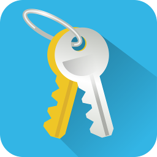

# Download

For your own security, download aWallet only from Apple App Store or Google Play. Other download sources may offer fake or tampered aWallet apps.

## Android

Download [aWallet Cloud](https://play.google.com/store/apps/details?id=org.awallet.cloud) or [aWallet](https://play.google.com/store/apps/details?id=org.awallet.free) for Android from Google Play.

-   [{ .app-icon }](https://play.google.com/store/apps/details?id=org.awallet.cloud)

    **aWallet Cloud**

    [{ .badge-play }](https://play.google.com/store/apps/details?id=org.awallet.cloud&pcampaignid=MKT-Other-global-all-co-prtnr-py-PartBadge-Mar2515-1)

-   [{ .app-icon }](https://play.google.com/store/apps/details?id=org.awallet.free)

    **aWallet**

    [{ .badge-play }](https://play.google.com/store/apps/details?id=org.awallet.free&pcampaignid=MKT-Other-global-all-co-prtnr-py-PartBadge-Mar2515-1)

## iOS

Download [aWallet Cloud](https://itunes.apple.com/app/id1194813074) or [aWallet](https://itunes.apple.com/app/id1203247013) for iOS iPhone/iPad on Apple App Store.

-   [{ .app-icon }](https://apps.apple.com/us/app/awallet-cloud-password-manager/id1194813074)

    **aWallet Cloud**

    [{ .badge-apple }](https://apps.apple.com/us/app/awallet-cloud-password-manager/id1194813074)

-   [{ .app-icon }](https://apps.apple.com/us/app/awallet-password-manager/id1203247013)

    **aWallet**

    [{ .badge-apple }](https://apps.apple.com/us/app/awallet-password-manager/id1203247013)

