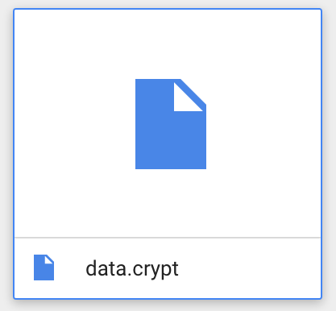
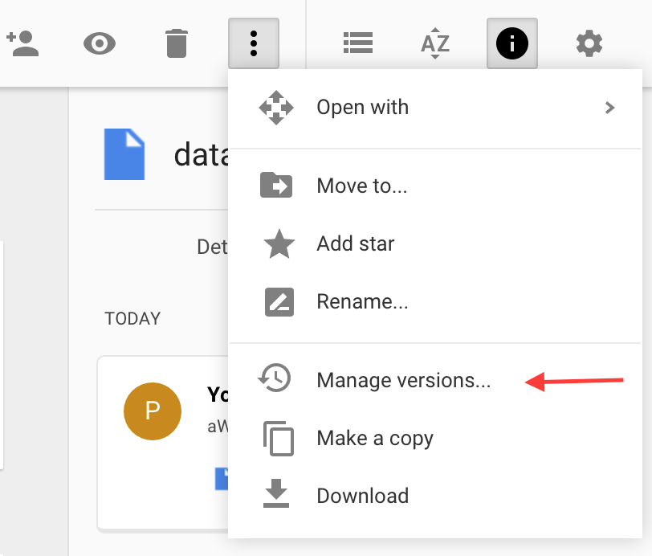
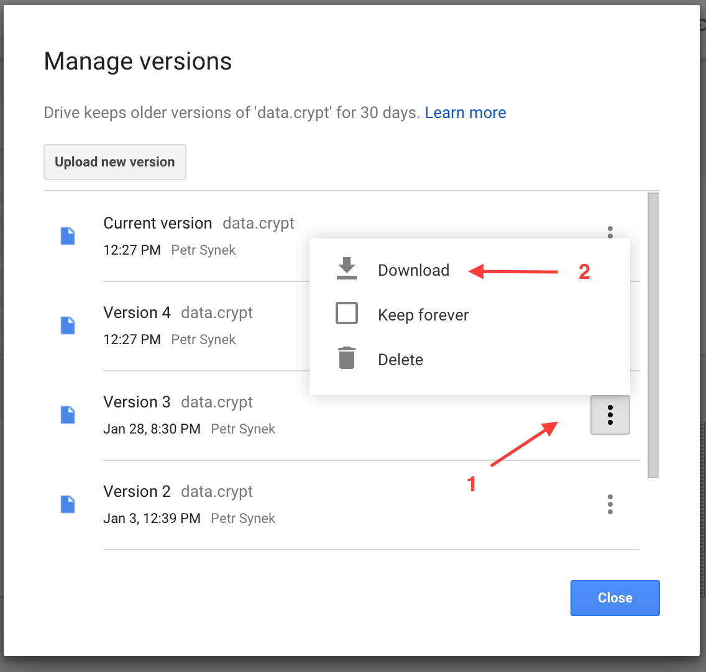
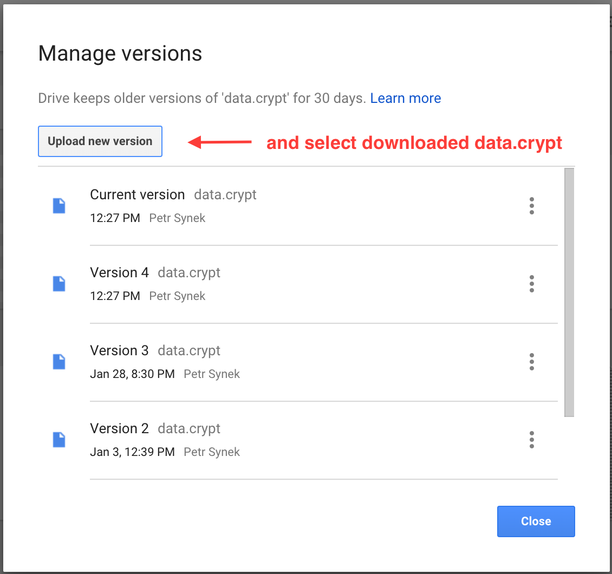

# Restore Google Drive revision

Open Google Drive page in desktop web browser: <https://drive.google.com/>

Select the data.crypt file:

Right-click on the data.crypt file and choose Manage revisions...

or click on 3 vertical dots in the top right corner | Manage revisions...

Download older revision of the data.crypt file to your PC/Mac:

Upload the downloaded file back as a new revision:

- Click the button "Upload new version"
- Choose the downloaded data.crypt file in your PC/Mac

Open aWallet Cloud in your Android phone or tablet and press the synchronize button on the home screen. aWallet Cloud will download the restored revision.

There is also a video showing all steps done in Google Drive:

<iframe width="560" height="315" src="https://www.youtube.com/embed/M7bKmEC68Bg" title="YouTube video" frameborder="0" allowfullscreen></iframe>
